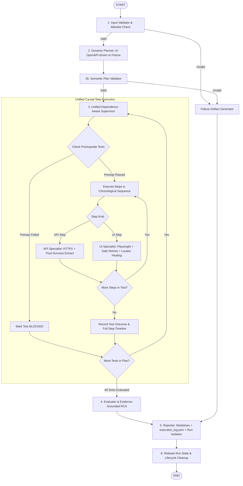

# SpecNetra AI — Architectural Design Document (DESIGN.md)

**Product Name:** SpecNetra AI  
**Tagline:** From Requirements to Reliable Tests  
**Version:** 1.0 (Audited & Verified Release)  
**Architecture:** Python Modular Monolith with LangGraph Orchestration  

---

## 1. Executive Summary & Core Decisions

SpecNetra AI ingests requirements (`requirements.md`), API contracts (`openapi.json`), and test scenarios (`scenarios.json`) to autonomously plan, semantically validate, and deterministically execute end-to-end tests across API and browser layers without manual script authoring.

### Fundamental Architectural Principle
> **AI plans and hypothesizes; deterministic execution engines and immutable assertions decide outcomes.**

1. **Python Modular Monolith:** Agents communicate through typed LangGraph state updates rather than inter-service network calls. This guarantees zero distributed race conditions, rapid execution, and complete reproducibility.
2. **Deterministic Verdicts:** Requests are dispatched via **HTTPX** (API) and browser automation via **Playwright** (Chromium). Verdicts (`PASSED`, `FAILED`, `ERROR`, `BLOCKED`) are governed strictly by deterministic assertion rules. LLMs are never permitted to alter assertions to force a false PASS.
3. **Unified Dependency-Aware Execution:** Tests execute in topological dependency order. Dependent tests are automatically marked **BLOCKED** if prerequisite tests fail or encounter errors.
4. **Target Independence:** Operation contracts (methods, paths, parameters, schemas, responses) are derived directly from OpenAPI specifications. SpecNetra tests unseen arbitrary targets without application-specific Python code edits.
5. **Selector Self-Healing:** Elements support ordered candidate locators. When a selector changes in the DOM, semantically equivalent fallbacks recover the step and log recovery evidence.
6. **Safe UI Retries:** Read-only checks (`navigate`, `assert_visible`, `assert_text`, `assert_url`, `screenshot`) are treated as idempotent, while mutating actions (`click_by_role`, `fill_by_label`) are strictly protected against blind retries.
7. **Run Isolation & Evidence Completeness:** Test artifacts are written to isolated directories (`output/<run_id>/`), accompanied by step-level execution logs, network/console diagnostics, and full lifecycle state release.

---

## 2. Multi-Agent Architecture & LangGraph State Machine

---

## 3. Core Subsystems and Contracts

### 3.1 Input Validator & Allowlist Security
- **Requirements Parser:** Ingests markdown files with alphanumeric requirement identifiers (`REQ-XXX`).
- **OpenAPI Validator:** Validates schema structure using `openapi_spec_validator`.
- **Target Host Security:** Enforces an explicit allowlist (`ALLOWED_TARGET_HOSTS`). Disallowed hosts or untrusted navigation targets trigger immediate security rejections.

### 3.2 Dynamic Planner & Semantic Validation
- **OpenAPI Inspection:** Derives HTTP methods, paths, parameters, schemas, and response contracts directly from the target OpenAPI specification.
- **AI Mode (`PLAN_MODE=ai`):** Leverages OpenAI `gpt-4o-mini` with structured Pydantic models.
- **Semantic Validator:** Rejects empty (zero-step) tests, unsupported actions, non-existent endpoints, or tests lacking verifiable assertions before execution begins.
- **Zero-Hardcoding Demonstration:** Validated against both the healthcare appointment demo and the secondary warehouse inventory management service.

### 3.3 Unified Dependency-Aware Supervisor
- **Topological Ordering:** Computes execution sequence from scenario dependency graphs.
- **Cascading Block Logic:** If prerequisite test `A` fails or errors, dependent test `B` transitions directly to `BLOCKED` with detailed dependency reasoning.
- **Mixed Ordered Workflows:** Executes API setup, browser verification, and backend confirmation in strict chronological order within a single unified timeline.

### 3.4 API & Browser Executors
- **Transactional State Commit:** Tokens and resource IDs (e.g. `appointment_id`) are committed to `RunStateManager` only after all step assertions pass.
- **Strict Response Assertions:** Missing or malformed JSON payloads trigger immediate assertion failures when schema or field assertions are specified.
- **Selector Self-Healing:** If a primary locator fails, ordered candidate locators (`role`, `label`, `testid`, `css`) are evaluated, and self-healing recovery metadata is captured.
- **Browser Diagnostics:** Actively collects browser console warnings/errors and failed network requests into step-level evidence.

### 3.5 Evaluator, RCA & Isolated Reporting
- **Explicit Outcome Policy:**
  - `PASSED`: All tests passed (`passed > 0`, `failed == 0`, `blocked == 0`).
  - `FAILED`: At least one test failed or errored.
  - `BLOCKED`: Prerequisite failure blocked tests without other failures.
- **Evidence-Grounded RCA:** Generates structured hypotheses referencing failing step indices, console logs, network response codes, and screenshot paths.
- **Uncovered Requirements Tracking:** Explicitly identifies specified requirements that lack verified passing tests.
- **Run Isolation:** Outputs artifacts to `output/<run_id>/` and mirrors them to `output/` for backward compatibility.
- **Memory Release:** Releases stored run state in `release_run_state_manager(run_id)` upon completion.
