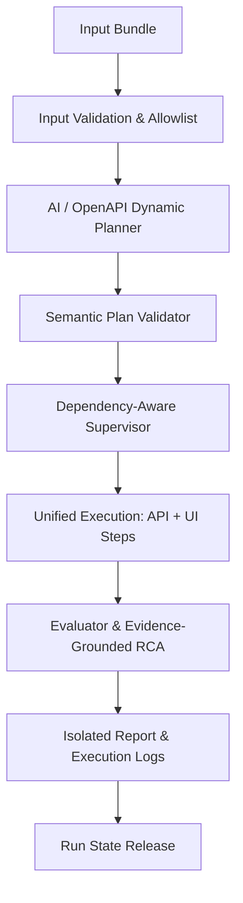

# SpecNetra AI

<p align="center">
  
</p>

<p align="center"><strong>From requirements to reliable tests.</strong><br />
An autonomous, evidence-first multi-agent testing framework for API and browser workflows.</p>

<p align="center">
  <a href="https://github.com/Sarthak702-droid/SpecNetra-AI/actions"></a>
  
  
</p>

## Why SpecNetra?

SpecNetra turns three ordinary inputs into executable, explainable verification:

```text
requirements.md + openapi.json + scenarios.json
                         |
                         v
       validated plan -> API/UI execution -> evidence-backed report
```

AI plans and analyzes tests; deterministic execution engines decide whether a test passes or fails. That boundary keeps results reproducible and makes defects trustworthy.

## What It Does

| Capability | Result |
| --- | --- |
| Multi-agent planning | Converts requirements and scenarios into a semantically validated `TestPlan`. |
| Target independence | Dynamically derives operations, methods, schemas, and assertions from any OpenAPI spec. |
| API contract testing | Sends real HTTP requests with HTTPX and validates OpenAPI response schemas. |
| Browser verification | Drives Chromium with Playwright using selector self-healing and diagnostics. |
| Cross-layer state | Carries runtime IDs (`appointment_id`, etc.) from API creation into UI checks. |
| Dependency blocking | Enforces topological test dependencies; prerequisites failures mark dependents as `BLOCKED`. |
| Bounded recovery | Retries transient failures with safe idempotency guards (mutations protected). |
| Evidence and RCA | Captures failure screenshots, console logs, network errors, and hypothesis RCA. |
| Security controls | Allowlisted target hosts, HTTP scheme verification, and secret redaction. |

## Run It

### One-Command Docker Compose

Healthy demonstration run:
```bash
docker compose up --build --abort-on-container-exit --exit-code-from runner
```
All services (`demo-api`, `demo-web`, `runner`) boot cleanly. Tests pass and reports are written to `output/` with exit code `0`.

Intentionally defective demonstration run:
```bash
DEMO_BUG_MODE=hide_created_appointment docker compose up --build --abort-on-container-exit --exit-code-from runner
```
SpecNetra detects the injected appointment-visibility defect in `SMK-003`, captures screenshot evidence, writes evidence-grounded RCA, and exits with code `1` (proving the defect was caught).

### Local Development

```bash
python3 -m venv .venv
source .venv/bin/activate
pip install -e ".[dev]"
python -m playwright install chromium
```

Run test layers:
```bash
pytest tests/unit/ -v               # Core models, assertions, scheduler, recovery, security
pytest tests/integration/ -v        # HTTPX API, Playwright browser, secondary target
pytest tests/end_to_end/ -v         # Full healthy and defective E2E runs
```

Run against an arbitrary target (e.g. secondary inventory service):
```bash
python -m app.main \
  --requirements inputs/demo_inventory/requirements.md \
  --openapi inputs/demo_inventory/openapi.json \
  --scenarios inputs/demo_inventory/scenarios.json \
  --api-url http://127.0.0.1:8001
```

## Execution Model



## Output Artifacts

```text
output/
├── <run_id>/             # Isolated run directory
│   ├── execution_log.json # Detailed step-level events, durations, retries, logs
│   ├── report.md          # Human-readable result, coverage matrix, and RCA
│   └── test_plan.json     # Validated execution plan
├── execution_log.json     # Latest execution log pointer
├── report.md              # Latest report pointer
├── test_plan.json         # Latest plan pointer
└── screenshots/           # Failure screenshots
```

## Project Map

| Path | Purpose |
| --- | --- |
| `app/agents/` | Planner, API, UI, supervisor, and evaluator nodes |
| `app/core/` | Validation, security, state manager, recovery, and test scheduling |
| `app/executors/` | Deterministic HTTPX and Playwright executors with self-healing |
| `app/reports/` | Evidence-grade reports, telemetry, and root-cause analysis |
| `demo/` | Authorized FastAPI target (`demo/api`) and Vite SPA (`demo/web`) |
| `inputs/` | Canonical appointment demo and secondary inventory demo inputs |
| `tests/` | Unit, integration, and end-to-end test suites |

## Design Principles

1. **AI plans and hypothesizes; deterministic code executes and judges.**
2. **Business assertions are immutable and never self-healed.**
3. **Dependencies are strictly respected; failing prerequisites mark dependents as `BLOCKED`.**
4. **Selector self-healing evaluates candidate locators and records recovery evidence.**
5. **Every test failure captures inspectable evidence (screenshots, console logs, network errors).**

For architectural depth, see [DESIGN.md](DESIGN.md).
