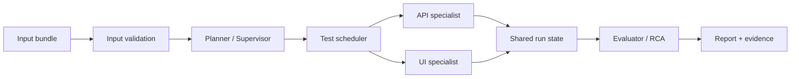

# SpecNetra AI

<p align="center">
  
</p>

<p align="center"><strong>From requirements to reliable tests.</strong><br />
An autonomous, evidence-first testing framework for API and browser workflows.</p>

<p align="center">
  <a href="https://github.com/Sarthak702-droid/SpecNetra-AI/actions"></a>
  
  
</p>

## Why SpecNetra?

SpecNetra turns three ordinary inputs into executable, explainable verification:

```text
requirements.md + openapi.json + scenarios.json
                         |
                         v
       validated plan -> API/UI execution -> evidence-backed report
```

AI is used for planning and analysis. Deterministic executors decide whether a test passes or fails. That boundary keeps results reproducible and makes defects easier to trust.

## What It Does

| Capability | Result |
| --- | --- |
| Multi-agent planning | Converts requirements and scenarios into a validated `TestPlan`. |
| API contract testing | Sends real HTTP requests with HTTPX and validates OpenAPI response schemas. |
| Browser verification | Drives Chromium with Playwright using semantic locator fallbacks. |
| Cross-layer state | Carries runtime IDs such as `appointment_id` from API setup into UI checks. |
| Bounded recovery | Retries only eligible transient failures with strict idempotency guards. |
| Evidence and RCA | Captures failure screenshots and separates verified facts from hypotheses. |
| Security controls | Allowlisted hosts, HTTP scheme checks, and sensitive value redaction. |

## Run It

### Docker Compose

Prerequisite: Docker with Compose.

```bash
docker compose up --build
```

This starts the demo API on `:8001`, the web app on `:3000`, and the test runner. Reports are written to `output/`.

To exercise the defect-detection path:

```bash
DEMO_BUG_MODE=hide_created_appointment docker compose up --build
```

The API creation check passes, the UI verification check fails, and the runner records the screenshot plus an RCA hypothesis.

### Local Development

```bash
python3 -m venv .venv
source .venv/bin/activate
pip install -e ".[dev]"
python -m playwright install chromium
```

Run the full suite or a focused layer:

```bash
pytest tests/ -v
pytest tests/unit/ -v
pytest tests/integration/ -v
pytest tests/end_to_end/ -v
```

Run the pipeline directly:

```bash
python -m app.main \
  --requirements inputs/requirements.md \
  --openapi inputs/openapi.json \
  --scenarios inputs/scenarios.json
```

## Execution Model



The architecture is deliberately conservative: a language model can propose a plan or explain evidence, but it cannot turn a failed assertion into a pass.

## Output Artifacts

```text
output/
├── execution_log.json    # Structured execution events
├── report.md             # Human-readable result and RCA
├── test_plan.json        # Validated execution plan
└── screenshots/          # UI failure evidence
```

## Project Map

| Path | Purpose |
| --- | --- |
| `app/agents/` | Planner, API, UI, supervisor, and evaluator agents |
| `app/core/` | Validation, security, state, recovery, and scheduling |
| `app/executors/` | Deterministic HTTP and browser execution |
| `app/reports/` | Reports and root-cause analysis |
| `demo/` | FastAPI and Vite demo target |
| `inputs/` | Requirements, OpenAPI, and scenario fixtures |
| `tests/` | Unit, integration, and end-to-end coverage |

## Design Principles

1. AI plans and analyzes; deterministic code executes and judges.
2. Business assertion failures are immutable and never self-healed.
3. Recovery is bounded, observable, and guarded by idempotency.
4. Every important failure should leave inspectable evidence.

More architectural detail is available in [DESIGN.md](DESIGN.md).

## Contributing

Create a focused branch, keep changes covered by the nearest test layer, and run `pytest tests/ -v` before opening a pull request. The CI workflow also checks Ruff and the healthy and defective end-to-end paths.
