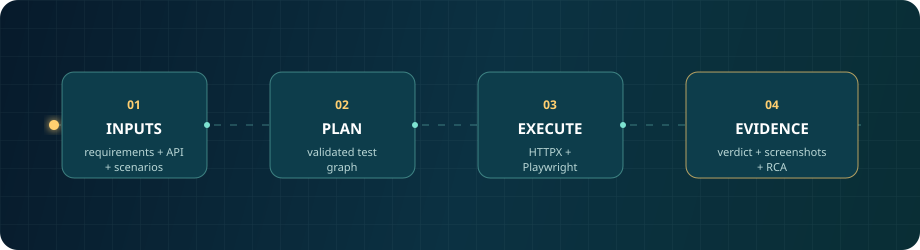
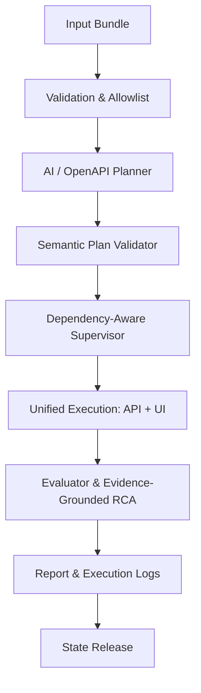

# SpecNetra AI

<p align="center">
  
</p>

<p align="center"><strong>From requirements to reliable tests — autonomously.</strong><br />
An evidence-first multi-agent verification framework for API and browser workflows.</p>

<p align="center">
  <a href="https://github.com/Sarthak702-droid/SpecNetra-AI/actions"></a>
  
  
  
</p>

## The Problem We Solve

Manual test authoring doesn't scale. SpecNetra takes three ordinary inputs and produces executable, explainable verification — without writing test scripts by hand.

```text
requirements.md + openapi.json + scenarios.json
                         |
                         v
       validated plan -> API/UI execution -> evidence-backed report
```

AI plans and analyzes; deterministic execution engines decide pass or fail. That boundary keeps results reproducible and makes defects trustworthy.

## Capabilities at a Glance

| Capability | What It Delivers |
| --- | --- |
| **Multi-agent planning** | Converts requirements and scenarios into a semantically validated `TestPlan`. |
| **Target independence** | Derives operations, methods, schemas, and assertions from any OpenAPI spec. |
| **API contract testing** | Sends real HTTP requests via HTTPX and validates response schemas. |
| **Browser verification** | Drives Chromium with Playwright — selector self-healing and diagnostics included. |
| **Visual AI assertions** | Optional Midscene SDK integration for semantic `ai_assert`, `ai_act`, `ai_query`. |
| **Cross-layer state** | Carries runtime IDs from API creation into UI checks. |
| **Dependency blocking** | Enforces topological dependencies; prerequisite failures mark dependents `BLOCKED`. |
| **Bounded recovery** | Retries transient failures with idempotency guards (mutations protected). |
| **Evidence & RCA** | Captures failure screenshots, console logs, network errors, and hypothesis RCA. |
| **Security controls** | Allowlisted hosts, HTTP scheme verification, and secret redaction. |

## How It Works

SpecNetra orchestrates a pipeline of specialized agents through LangGraph. Each agent handles one concern — planning, API execution, browser execution, evaluation, or reporting — and communicates through typed state updates. The supervisor enforces topological execution order and cascading failure logic.

## Quick Start

### Docker Compose (One Command)

```bash
# Healthy target — all tests should pass
docker compose up --build --abort-on-container-exit --exit-code-from runner

# Defective target — SpecNetra catches the injected bug
DEMO_BUG_MODE=hide_created_appointment docker compose up --build --abort-on-container-exit --exit-code-from runner
```

### Local Development

```bash
python3 -m venv .venv
source .venv/bin/activate
pip install -e ".[dev]"
python -m playwright install chromium
```

Run test layers:
```bash
pytest tests/unit/ -v               # Models, assertions, scheduler, recovery, security
pytest tests/integration/ -v        # HTTPX API, Playwright browser, Midscene bridge
pytest tests/end_to_end/ -v         # Full healthy and defective E2E runs
```

Run against any target:
```bash
python -m app.main \
  --requirements inputs/requirements.md \
  --openapi inputs/openapi.json \
  --scenarios inputs/scenarios.json \
  --api-url http://127.0.0.1:8001 \
  --web-url http://127.0.0.1:3000
```

## Execution Model



## Output Artifacts

```text
output/
├── <run_id>/             # Isolated run directory
│   ├── execution_log.json # Step-level events, durations, retries
│   ├── report.md          # Verification report with coverage matrix & RCA
│   └── test_plan.json     # Validated execution plan
├── execution_log.json     # Latest execution log
├── report.md              # Latest report
├── test_plan.json         # Latest plan
└── screenshots/           # Failure screenshots
```

## Project Map

| Path | Purpose |
| --- | --- |
| `app/agents/` | Planner, API, UI, supervisor, and evaluator nodes |
| `app/core/` | Validation, security, state manager, recovery, scheduling |
| `app/executors/` | HTTPX, Playwright, and Midscene worker executors |
| `app/reports/` | Evidence-grade reports, telemetry, and RCA |
| `browser-worker/` | Node.js/TypeScript Midscene visual AI bridge |
| `demo/` | FastAPI target (`demo/api`) and Vite SPA (`demo/web`) |
| `inputs/` | Canonical demo and secondary inventory inputs |
| `tests/` | Unit, integration, and end-to-end suites |

## Design Principles

1. **AI plans and hypothesizes; deterministic code executes and judges.**
2. **Business assertions are immutable — never self-healed.**
3. **Dependencies strictly respected; failing prerequisites cascade to `BLOCKED`.**
4. **Selector self-healing evaluates candidates and records recovery evidence.**
5. **Every failure captures inspectable evidence: screenshots, console logs, network errors.**

For architectural details, see [DESIGN.md](DESIGN.md).

---

<p align="center"><sub>Built by <a href="https://github.com/Sarthak702-droid">Sarthak Tripathy</a></sub></p>
