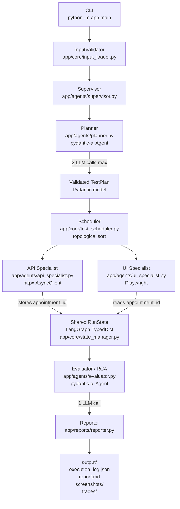
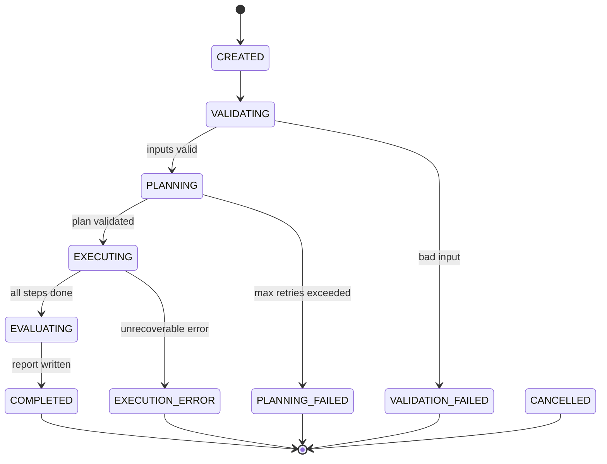

# SpecNetra AI — Implementation Plan

> **Status:** Awaiting user approval before any code is written.

## Goal Description

Build **SpecNetra AI**, an autonomous multi-agent software testing framework that converts application requirements (`requirements.md`), API specifications (`openapi.json`), and user scenarios (`scenarios.json`) into executable tests — then runs them and produces an evidence-backed report.

The MVP is a **Python modular monolith** orchestrated with **LangGraph 1.2**. Four logical agents — Planner/Supervisor, API Specialist, UI Specialist, and Evaluator/RCA — cooperate through a typed shared state. Execution is deterministic (HTTPX + Playwright); only planning and RCA analysis use LLM calls (via **pydantic-ai 2.54**).

The deliverable is a `docker compose up --build` one-command startup that:
1. Launches a small demo appointment-management app (FastAPI backend + minimal Vite/TS frontend).
2. Runs the SpecNetra framework against it.
3. Detects a deliberately introduced UI bug.
4. Produces `output/execution_log.json` and `output/report.md`.

---

## User Review Required

> [!IMPORTANT]
> **CI Tests (as requested):** This plan adds a **GitHub Actions workflow** (`.github/workflows/ci.yml`) covering lint → unit → integration → e2e test jobs. Please confirm: is GitHub Actions the correct CI platform, or do you use GitLab CI / another?

> [!IMPORTANT]
> **LLM Provider:** The plan defaults to **OpenAI** (`gpt-4o-mini`) as the pydantic-ai provider. The adapter is configurable via `.env`. Please confirm your preferred provider (OpenAI / Anthropic / Gemini / local Ollama).

> [!WARNING]
> **`uv` not installed on host:** `uv` is not present on your machine (`uv not installed` confirmed). The Dockerfile installs `uv` inside Docker automatically. For local development, run: `curl -LsSf https://astral.sh/uv/install.sh | sh` before working outside Docker. The plan uses `uv` everywhere for reproducibility.

> [!NOTE]
> **Demo frontend:** PRD §11 allows "simple HTML/JavaScript for a faster first iteration." This plan uses **Vite + plain TypeScript** (no React framework) to keep Docker build fast and dependencies minimal. Please confirm or request React.

---

## Open Questions

> [!IMPORTANT]
> 1. **CI platform:** GitHub Actions assumed. Correct?
> 2. **LLM provider:** OpenAI (`gpt-4o-mini`) assumed. Correct?
> 3. **Frontend:** Plain Vite/TS (faster) vs React/Vite for the demo app?
> 4. **Playwright traces:** Enable on every run or only on failure? (Plan default: failure-only to save disk.)
> 5. **Schemathesis (P1):** Scaffold the file with a TODO stub, or skip entirely for now?

---

## Dependency Versions (Confirmed by Research)

| Package | Version | Key API note |
|---|---|---|
| `langgraph` | `1.2.14` | `StateGraph`, `add_conditional_edges`, `START`/`END` constants |
| `pydantic-ai` | `2.54.0` | **`output_type=`** (NOT `result_type` — renamed in 2.x) |
| `pydantic` | `2.7+` | `BaseModel`, `Field(default_factory=...)` |
| `httpx` | `0.27+` | `AsyncClient`, single client per run session |
| `playwright` | latest | `async_playwright`, `BrowserContext` per test |
| `openapi-spec-validator` | `0.7+` | `validate(spec_dict)` or `OpenAPIV31SpecValidator(spec_dict).validate()` |
| `python` | `3.12.3` ✓ | Installed on host |

---

## Architecture Overview





---

## Proposed Changes

### Component 1 — Project Scaffold & Configuration

---

#### [NEW] `pyproject.toml`

```toml
[project]
name = "specnetra-ai"
version = "1.0.0"
requires-python = ">=3.12"
dependencies = [
  "langgraph>=1.2",
  "pydantic>=2.7",
  "pydantic-ai>=2.54",
  "pydantic-settings>=2.3",
  "httpx>=0.27",
  "playwright>=1.45",
  "jsonschema>=4.23",
  "openapi-spec-validator>=0.7",
  "python-dotenv>=1.0",
  "structlog>=24.1",
  "fastapi>=0.112",
  "uvicorn[standard]>=0.30",
  "anyio>=4.4",
]

[dependency-groups]
dev = [
  "pytest>=8.3",
  "pytest-asyncio>=0.23",
  "ruff>=0.5",
  "httpx[cli]>=0.27",
]

[tool.pytest.ini_options]
asyncio_mode = "auto"
testpaths = ["tests"]
markers = ["unit", "integration", "e2e"]

[tool.ruff]
line-length = 100
target-version = "py312"
select = ["E", "F", "I", "UP"]
```

#### [NEW] `.env.example`

```dotenv
# LLM Configuration
LLM_PROVIDER=openai
LLM_MODEL=gpt-4o-mini
LLM_API_KEY=

# Target Application
API_BASE_URL=http://demo-api:8001
WEB_BASE_URL=http://demo-web:3000
ALLOWED_TARGET_HOSTS=demo-api,demo-web

# Test Credentials (never commit real values)
TEST_USER_EMAIL=tester@example.test
TEST_USER_PASSWORD=

# Execution Settings
TEST_TIMEOUT_MS=15000
MAX_RETRIES=2
MAX_TESTS_PER_RUN=10
BROWSER_HEADLESS=true
OUTPUT_DIR=output
TARGET_ENVIRONMENT=staging

# Demo bug switch (set to "hide_created_appointment" to trigger defect)
DEMO_BUG_MODE=
```

#### [NEW] `app/config.py`

```python
from pydantic import Field
from pydantic_settings import BaseSettings

class Settings(BaseSettings):
    llm_provider: str = "openai"
    llm_model: str = "gpt-4o-mini"
    llm_api_key: str = Field(..., repr=False)

    api_base_url: str = "http://demo-api:8001"
    web_base_url: str = "http://demo-web:3000"
    allowed_target_hosts: list[str] = ["demo-api", "demo-web"]

    test_user_email: str = "tester@example.test"
    test_user_password: str = Field(..., repr=False)

    test_timeout_ms: int = 15000
    max_retries: int = 2
    max_tests_per_run: int = 10
    browser_headless: bool = True
    output_dir: str = "output"
    target_environment: str = "staging"
    demo_bug_mode: str = ""

    model_config = {"env_file": ".env", "env_file_encoding": "utf-8"}

settings = Settings()
```

---

### Component 2 — Pydantic Models

---

#### [NEW] `app/models.py`

All typed contracts shared across agents. Uses **discriminated unions** for step types.

```python
from typing import Literal, Annotated
import operator
from pydantic import BaseModel, Field
from typing_extensions import TypedDict

# ── Input Models ──────────────────────────────────────────────────────────────

class Requirement(BaseModel):
    req_id: str           # e.g. "REQ-001"
    title: str
    priority: Literal["P0", "P1", "P2"]
    description: str

class ScenarioOperation(BaseModel):
    kind: Literal["api", "ui"]
    operation_id: str | None = None
    action: str | None = None
    expect_failure: bool = False
    invalid_body: bool = False

class Scenario(BaseModel):
    id: str
    name: str
    requirement_ids: list[str] = Field(min_length=1)
    priority: Literal["P0", "P1", "P2"]
    dependencies: list[str] = Field(default_factory=list)
    operations: list[ScenarioOperation]

class InputBundle(BaseModel):
    requirements: list[Requirement]
    scenarios: list[Scenario]
    openapi_doc: dict

# ── Test Plan Models ───────────────────────────────────────────────────────────

class APIStep(BaseModel):
    kind: Literal["api_request"] = "api_request"
    operation_id: str
    method: Literal["GET", "POST", "PUT", "PATCH", "DELETE"]
    path: str
    body: dict | None = None
    assertions: list[dict] = Field(default_factory=list)
    extract: dict[str, str] = Field(default_factory=dict)  # field -> ref_key

class UIStep(BaseModel):
    kind: Literal["ui_action"] = "ui_action"
    action: Literal[
        "navigate", "fill_by_label", "click_by_role",
        "assert_visible", "assert_text", "assert_url", "screenshot"
    ]
    params: dict = Field(default_factory=dict)

class TestCase(BaseModel):
    test_id: str
    requirement_ids: list[str] = Field(min_length=1)
    priority: Literal["P0", "P1", "P2"]
    category: Literal["api", "ui", "cross_layer"]
    dependencies: list[str] = Field(default_factory=list)
    steps: list[APIStep | UIStep]
    expected: str
    timeout_ms: int = 15000
    max_retries: int = 2

class TestPlan(BaseModel):
    plan_id: str
    tests: list[TestCase] = Field(min_length=1, max_length=20)

# ── Execution Result Models ────────────────────────────────────────────────────

class StepResult(BaseModel):
    step_index: int
    outcome: Literal["PASSED", "FAILED", "ERROR", "SKIPPED"]
    observed: str
    duration_ms: float
    retry_count: int = 0
    evidence_ids: list[str] = Field(default_factory=list)
    error_code: str | None = None

class TestResult(BaseModel):
    test_id: str
    requirement_ids: list[str]
    outcome: Literal["PASSED", "FAILED", "ERROR", "BLOCKED", "SKIPPED"]
    expected: str
    observed: str
    step_results: list[StepResult] = Field(default_factory=list)
    evidence_ids: list[str] = Field(default_factory=list)
    retry_count: int = 0
    duration_ms: float = 0.0
    error_code: str | None = None

# ── Shared Run State (LangGraph TypedDict) ────────────────────────────────────

class ResourceRefs(BaseModel):
    appointment_id: str | None = None

class AuthState(BaseModel):
    session_ref: str | None = None   # opaque ref; raw token NEVER stored here
    token_store_key: str | None = None

class RunState(TypedDict):
    run_id: str
    run_phase: str        # CREATED | VALIDATING | PLANNING | EXECUTING | EVALUATING | COMPLETED | ...
    input_bundle: InputBundle | None
    test_plan: TestPlan | None
    resource_refs: ResourceRefs
    auth_state: AuthState
    # Reducers: list fields use operator.add to accumulate across nodes
    test_results: Annotated[list[TestResult], operator.add]
    evidence_manifest: Annotated[list[dict], operator.add]
    errors: Annotated[list[str], operator.add]
    evaluation: dict | None

# ── RCA Models ────────────────────────────────────────────────────────────────

class RCAFinding(BaseModel):
    test_id: str
    requirement_ids: list[str]
    observed_evidence: str
    hypothesis: str
    confidence: Literal["high", "medium", "low"]
    next_debug_step: str
```

---

### Component 3 — Core Utilities

---

#### [NEW] `app/core/input_loader.py`

```python
import re, json
from pathlib import Path
from openapi_spec_validator import validate as validate_openapi_spec

REQ_ID_PATTERN = re.compile(r"^##\s+(REQ-\d+)", re.MULTILINE)

async def load_inputs(
    req_path: Path, openapi_path: Path, scenarios_path: Path
) -> InputBundle:
    # 1. Check files exist
    for p in [req_path, openapi_path, scenarios_path]:
        if not p.exists():
            raise InputValidationError(f"Missing required file: {p}")

    # 2. Parse requirements.md
    req_text = req_path.read_text()
    requirements = parse_requirements(req_text)
    check_duplicate_req_ids(requirements)

    # 3. Validate + parse openapi.json
    openapi_doc = json.loads(openapi_path.read_text())
    validate_openapi_spec(openapi_doc)  # raises on invalid

    # 4. Parse + validate scenarios.json
    scenarios_data = json.loads(scenarios_path.read_text())
    scenarios = [Scenario(**s) for s in scenarios_data["scenarios"]]
    req_ids = {r.req_id for r in requirements}
    for sc in scenarios:
        for rid in sc.requirement_ids:
            if rid not in req_ids:
                raise InputValidationError(
                    f"Scenario {sc.id} references unknown requirement {rid}"
                )

    return InputBundle(
        requirements=requirements,
        scenarios=scenarios,
        openapi_doc=openapi_doc,
    )
```

#### [NEW] `app/core/security.py`

```python
from urllib.parse import urlparse
from app.config import settings

REDACTED = "[REDACTED]"
SENSITIVE_KEYS = {"authorization", "password", "token", "cookie", "set-cookie"}

def is_allowed_host(url: str) -> bool:
    parsed = urlparse(url)
    return parsed.hostname in settings.allowed_target_hosts

def assert_allowed_url(url: str) -> None:
    if not is_allowed_host(url):
        raise SecurityError(f"Target host not in allowlist: {url}")

def redact_headers(headers: dict) -> dict:
    return {
        k: REDACTED if k.lower() in SENSITIVE_KEYS else v
        for k, v in headers.items()
    }

def sanitize_for_prompt(data: dict) -> dict:
    """Remove sensitive keys before sending to LLM."""
    return {k: v for k, v in data.items() if k.lower() not in SENSITIVE_KEYS}
```

#### [NEW] `app/core/state_manager.py`

Thread-safe resource reference store per run:

```python
import asyncio
from typing import Any

class RunStateManager:
    def __init__(self, run_id: str):
        self._run_id = run_id
        self._resources: dict[str, Any] = {}
        self._tokens: dict[str, str] = {}  # key -> token; never logged
        self._lock = asyncio.Lock()

    async def store_resource(self, key: str, value: Any) -> None:
        async with self._lock:
            self._resources[key] = value

    async def get_resource(self, key: str) -> Any | None:
        async with self._lock:
            return self._resources.get(key)

    async def store_token(self, ref_key: str, token: str) -> None:
        async with self._lock:
            self._tokens[ref_key] = token

    async def get_token(self, ref_key: str) -> str | None:
        async with self._lock:
            return self._tokens.get(ref_key)
```

#### [NEW] `app/core/test_scheduler.py`

```python
from collections import defaultdict, deque
from app.models import TestCase

def topological_sort(tests: list[TestCase]) -> list[list[TestCase]]:
    """Returns batches of tests that can execute concurrently (within each batch)."""
    id_to_test = {t.test_id: t for t in tests}
    in_degree = defaultdict(int)
    dependents = defaultdict(list)

    for test in tests:
        for dep in test.dependencies:
            if dep not in id_to_test:
                raise SchedulerError(f"Unknown dependency: {dep}")
            dependents[dep].append(test.test_id)
            in_degree[test.test_id] += 1

    queue = deque([t for t in tests if in_degree[t.test_id] == 0])
    batches = []

    while queue:
        batch = []
        next_queue = deque()
        while queue:
            t = queue.popleft()
            batch.append(t)
            for dep_id in dependents[t.test_id]:
                in_degree[dep_id] -= 1
                if in_degree[dep_id] == 0:
                    next_queue.append(id_to_test[dep_id])
        batches.append(batch)
        queue = next_queue

    resolved = sum(len(b) for b in batches)
    if resolved != len(tests):
        raise SchedulerError("Circular dependency detected in test plan")

    return batches

def order_for_execution(tests: list[TestCase]) -> list[TestCase]:
    """Flat ordered list respecting dependencies."""
    return [t for batch in topological_sort(tests) for t in batch]
```

#### [NEW] `app/core/recovery.py`

```python
import asyncio, time
from dataclasses import dataclass
from typing import Callable, TypeVar

T = TypeVar("T")

TRANSIENT_ERROR_CODES = {"CONN_TIMEOUT", "HTTP_429", "HTTP_503", "LLM_INVALID_JSON"}

@dataclass
class RetryPolicy:
    max_retries: int = 2
    backoff_base_ms: int = 1000
    eligible_codes: frozenset[str] = frozenset(TRANSIENT_ERROR_CODES)
    is_idempotent: bool = True  # MUST be False for POST without idempotency key

async def with_retry(
    fn: Callable,
    policy: RetryPolicy,
    *args,
    **kwargs,
) -> T:
    last_error = None
    for attempt in range(policy.max_retries + 1):
        try:
            return await fn(*args, **kwargs)
        except RecoverableError as e:
            if e.code not in policy.eligible_codes:
                raise
            if not policy.is_idempotent and attempt > 0:
                raise SafetyError("Won't retry non-idempotent op without idempotency key")
            last_error = e
            wait_ms = policy.backoff_base_ms * (2 ** attempt)
            await asyncio.sleep(wait_ms / 1000)
    raise last_error
```

#### [NEW] `app/core/contract_validation.py`

```python
import jsonschema
from typing import Any

def validate_response_schema(response_body: Any, schema: dict) -> list[str]:
    """Returns list of validation errors (empty = valid)."""
    validator = jsonschema.Draft7Validator(schema)
    return [e.message for e in validator.iter_errors(response_body)]

def extract_response_schema(openapi_doc: dict, operation_id: str, status: int) -> dict | None:
    """Locate the response schema for a given operation + status code from OpenAPI doc."""
    for path_item in openapi_doc.get("paths", {}).values():
        for op in path_item.values():
            if isinstance(op, dict) and op.get("operationId") == operation_id:
                responses = op.get("responses", {})
                response = responses.get(str(status), responses.get("default"))
                if response:
                    content = response.get("content", {})
                    json_schema = content.get("application/json", {}).get("schema")
                    return json_schema
    return None
```

#### [NEW] `app/core/logging.py`

```python
import logging, json, sys
from datetime import datetime, timezone

class JSONFormatter(logging.Formatter):
    SENSITIVE = {"password", "token", "authorization", "cookie"}

    def format(self, record: logging.LogRecord) -> str:
        data = {
            "timestamp": datetime.now(timezone.utc).isoformat(),
            "level": record.levelname,
            "logger": record.name,
            "message": record.getMessage(),
            "run_id": getattr(record, "run_id", None),
            "test_id": getattr(record, "test_id", None),
            "agent": getattr(record, "agent", None),
        }
        if record.exc_info:
            data["exception"] = self.formatException(record.exc_info)
        return json.dumps({k: v for k, v in data.items() if v is not None})

def configure_logging(level: str = "INFO") -> None:
    handler = logging.StreamHandler(sys.stdout)
    handler.setFormatter(JSONFormatter())
    logging.root.setLevel(level)
    logging.root.handlers = [handler]
```

---

### Component 4 — Executors

---

#### [NEW] `app/executors/api_executor.py`

```python
import httpx, time
from app.models import APIStep, StepResult, RunState
from app.core.security import assert_allowed_url, redact_headers
from app.executors.assertions import assert_status, assert_json_schema, assert_field

async def execute_api_step(
    step: APIStep,
    state: RunState,
    client: httpx.AsyncClient,
    state_manager: RunStateManager,
    output_dir: Path,
) -> StepResult:
    url = f"{settings.api_base_url}{step.path}"
    assert_allowed_url(url)  # security gate

    token = await state_manager.get_token(state["auth_state"].token_store_key or "")
    headers = {"Authorization": f"Bearer {token}"} if token else {}

    start = time.monotonic()
    try:
        response = await client.request(
            method=step.method,
            url=url,
            json=step.body,
            headers=headers,
            timeout=settings.test_timeout_ms / 1000,
        )
    except httpx.ConnectTimeout:
        raise RecoverableError(code="CONN_TIMEOUT", message="Connection timed out")
    except httpx.HTTPStatusError as e:
        if e.response.status_code == 429:
            raise RecoverableError(code="HTTP_429", message="Rate limited")

    duration_ms = (time.monotonic() - start) * 1000
    body = response.json() if "application/json" in response.headers.get("content-type", "") else None

    # Assertions
    errors = []
    for assertion in step.assertions:
        kind = assertion["kind"]
        if kind == "assert_status":
            result = assert_status(response.status_code, assertion["expected"])
            if not result.passed:
                errors.append(result.message)
        elif kind == "assert_json_schema" and body:
            errs = validate_response_schema(body, assertion["schema"])
            errors.extend(errs)
        elif kind == "assert_field" and body:
            result = assert_field(body, assertion["path"], assertion["expected"])
            if not result.passed:
                errors.append(result.message)

    # Extract resource references
    for field_path, ref_key in step.extract.items():
        value = _extract_field(body, field_path)
        if value:
            await state_manager.store_resource(ref_key, value)

    outcome = "FAILED" if errors else "PASSED"
    return StepResult(
        step_index=0,
        outcome=outcome,
        observed="; ".join(errors) if errors else f"HTTP {response.status_code}",
        duration_ms=duration_ms,
        error_code="API_ASSERTION_FAILED" if errors else None,
    )
```

#### [NEW] `app/executors/browser_executor.py`

```python
from playwright.async_api import Page, BrowserContext
from app.models import UIStep, StepResult

LOCATOR_PRIORITY = ["role", "label", "testid", "css"]

async def resolve_locator(page: Page, params: dict):
    """Locator fallback chain per FR-006 priority."""
    if role := params.get("role"):
        return page.get_by_role(role, name=params.get("name"))
    if label := params.get("label"):
        return page.get_by_label(label)
    if testid := params.get("testid"):
        return page.get_by_test_id(testid)
    if css := params.get("css"):
        return page.locator(css)
    raise LocatorResolutionError("No valid locator params provided")

async def execute_ui_step(
    step: UIStep,
    page: Page,
    state_manager: RunStateManager,
    output_dir: Path,
    test_id: str,
) -> StepResult:
    start = time.monotonic()
    try:
        match step.action:
            case "navigate":
                url = step.params["url"]
                # Substitute resource refs: {appointment_id} -> actual value
                if "{appointment_id}" in url:
                    apt_id = await state_manager.get_resource("appointment_id")
                    url = url.replace("{appointment_id}", apt_id or "")
                assert_allowed_url(url)
                await page.goto(url, timeout=settings.test_timeout_ms)

            case "fill_by_label":
                loc = await resolve_locator(page, step.params)
                await loc.fill(step.params["value"])

            case "click_by_role":
                loc = await resolve_locator(page, step.params)
                await loc.click()

            case "assert_visible":
                loc = await resolve_locator(page, step.params)
                is_visible = await loc.is_visible()
                if not is_visible:
                    await _take_screenshot(page, output_dir, test_id)
                    return StepResult(
                        step_index=0, outcome="FAILED",
                        observed=f"Element not visible: {step.params}",
                        duration_ms=(time.monotonic() - start) * 1000,
                        error_code="UI_ASSERTION_FAILED",
                        evidence_ids=[f"screenshots/{test_id}.png"],
                    )

            case "assert_text":
                loc = await resolve_locator(page, step.params)
                actual = await loc.inner_text()
                if step.params["expected"] not in actual:
                    await _take_screenshot(page, output_dir, test_id)
                    return StepResult(...)  # FAILED

            case "assert_url":
                actual = page.url
                if step.params["expected"] not in actual:
                    return StepResult(outcome="FAILED", ...)

        duration_ms = (time.monotonic() - start) * 1000
        return StepResult(step_index=0, outcome="PASSED",
                          observed="OK", duration_ms=duration_ms)

    except Exception as e:
        await _take_screenshot(page, output_dir, test_id)
        return StepResult(step_index=0, outcome="ERROR",
                          observed=str(e), duration_ms=...,
                          error_code="BROWSER_ERROR",
                          evidence_ids=[f"screenshots/{test_id}.png"])
```

#### [NEW] `app/executors/assertions.py`

```python
from dataclasses import dataclass

@dataclass
class AssertionResult:
    passed: bool
    message: str

def assert_status(actual: int, expected: int) -> AssertionResult:
    passed = actual == expected
    return AssertionResult(passed, f"Expected status {expected}, got {actual}" if not passed else "")

def assert_field(body: dict, path: str, expected) -> AssertionResult:
    """Dot-notation path: e.g. 'data.id'"""
    parts = path.split(".")
    val = body
    for part in parts:
        if isinstance(val, dict):
            val = val.get(part)
        else:
            return AssertionResult(False, f"Path {path} not found in response")
    if expected is None:  # just checking non-null
        passed = val is not None and val != ""
        return AssertionResult(passed, f"Field {path} is empty" if not passed else "")
    passed = val == expected
    return AssertionResult(passed, f"Expected {path}={expected!r}, got {val!r}" if not passed else "")
```

---

### Component 5 — Agents

---

#### [NEW] `app/agents/planner.py`

Uses **pydantic-ai 2.54** with `output_type=TestPlan`:

```python
from pydantic_ai import Agent
from app.models import TestPlan, InputBundle
from app.config import settings

PLANNER_SYSTEM_PROMPT = """
You are a test planner for SpecNetra AI.
Generate a structured TestPlan from the provided requirements and OpenAPI spec.

Rules:
- Every test must reference at least one valid requirement ID.
- Every test must have a verifiable expected result string.
- Only use allowed step kinds: api_request, ui_action.
- Allowed ui actions: navigate, fill_by_label, click_by_role, assert_visible, assert_text, assert_url, screenshot.
- Never generate: shell, python_eval, sql, or any other commands.
- Max 10 tests total.
- P0 tests (smoke) must come before P1 tests (regression) in the list.
"""

_planner_agent = Agent(
    f"{settings.llm_provider}:{settings.llm_model}",
    output_type=TestPlan,           # pydantic-ai 2.x API
    system_prompt=PLANNER_SYSTEM_PROMPT,
)

MAX_PLANNING_RETRIES = 2

async def generate_test_plan(bundle: InputBundle) -> TestPlan:
    prompt = _build_planning_prompt(bundle)
    last_error = None
    for attempt in range(MAX_PLANNING_RETRIES + 1):
        try:
            result = await _planner_agent.run(prompt)
            plan = result.output  # pydantic-ai 2.x: result.output (not result.data)
            _validate_plan_against_bundle(plan, bundle)
            return plan
        except Exception as e:
            last_error = e
    raise PlanningFailedError(f"Planning failed after {MAX_PLANNING_RETRIES} retries: {last_error}")

def _build_planning_prompt(bundle: InputBundle) -> str:
    """Sanitized prompt — no auth credentials or secrets."""
    req_text = "\n".join(
        f"{r.req_id} ({r.priority}): {r.title}\n  {r.description}"
        for r in bundle.requirements
    )
    ops_text = _extract_operation_summaries(bundle.openapi_doc)
    return f"Requirements:\n{req_text}\n\nAvailable API operations:\n{ops_text}"
```

#### [NEW] `app/agents/supervisor.py`

LangGraph entry node — orchestrates validation → planning → scheduling:

```python
async def validate_inputs_node(state: RunState) -> dict:
    try:
        bundle = await load_inputs(...)
        return {"input_bundle": bundle, "run_phase": "PLANNING", "errors": []}
    except InputValidationError as e:
        return {"run_phase": "VALIDATION_FAILED", "errors": [str(e)]}

async def plan_tests_node(state: RunState) -> dict:
    try:
        plan = await generate_test_plan(state["input_bundle"])
        return {"test_plan": plan, "run_phase": "EXECUTING"}
    except PlanningFailedError as e:
        return {"run_phase": "PLANNING_FAILED", "errors": [str(e)]}
```

#### [NEW] `app/agents/api_specialist.py`

```python
async def execute_api_node(state: RunState) -> dict:
    tests = [t for t in state["test_plan"].tests if t.category in ("api", "cross_layer")]
    results = []
    async with httpx.AsyncClient() as client:
        for test in tests:
            result = await run_test_with_retry(test, client, state_manager)
            results.append(result)
    return {"test_results": results}
```

#### [NEW] `app/agents/ui_specialist.py`

```python
async def execute_ui_node(state: RunState) -> dict:
    tests = [t for t in state["test_plan"].tests if t.category in ("ui", "cross_layer")]
    results = []
    async with async_playwright() as p:
        browser = await p.chromium.launch(headless=settings.browser_headless)
        context = await browser.new_context()
        page = await context.new_page()
        for test in tests:
            result = await run_ui_test(test, page, state_manager, output_dir)
            results.append(result)
        await browser.close()
    return {"test_results": results}
```

#### [NEW] `app/agents/evaluator.py`

Uses **pydantic-ai** with `output_type=list[RCAFinding]`:

```python
_evaluator_agent = Agent(
    f"{settings.llm_provider}:{settings.llm_model}",
    output_type=list[RCAFinding],
    system_prompt=EVALUATOR_SYSTEM_PROMPT,
)

async def evaluate_node(state: RunState) -> dict:
    failed = [r for r in state["test_results"] if r.outcome in ("FAILED", "ERROR")]
    if not failed:
        return {"evaluation": {"findings": [], "summary": "All tests passed"}}

    # Build sanitized evidence (no tokens/passwords)
    evidence = _build_evidence_summary(failed, state["evidence_manifest"])
    try:
        result = await _evaluator_agent.run(evidence)
        findings = result.output
    except Exception:
        findings = _deterministic_classify(failed)  # fallback

    return {"evaluation": {"findings": [f.model_dump() for f in findings]}}
```

---

### Component 6 — LangGraph Workflow

---

#### [NEW] `app/graph.py`

```python
from langgraph.graph import StateGraph, START, END
from app.models import RunState
from app.agents.supervisor import validate_inputs_node, plan_tests_node
from app.agents.api_specialist import execute_api_node
from app.agents.ui_specialist import execute_ui_node
from app.agents.evaluator import evaluate_node
from app.reports.reporter import report_node

def _route_after_validation(state: RunState) -> str:
    return "plan_tests" if state["run_phase"] == "PLANNING" else END

def _route_after_planning(state: RunState) -> str:
    return "execute_api" if state["run_phase"] == "EXECUTING" else END

builder = StateGraph(RunState)

builder.add_node("validate_inputs", validate_inputs_node)
builder.add_node("plan_tests", plan_tests_node)
builder.add_node("execute_api", execute_api_node)
builder.add_node("execute_ui", execute_ui_node)
builder.add_node("evaluate", evaluate_node)
builder.add_node("report", report_node)

builder.add_edge(START, "validate_inputs")
builder.add_conditional_edges("validate_inputs", _route_after_validation)
builder.add_conditional_edges("plan_tests", _route_after_planning)
builder.add_edge("execute_api", "execute_ui")
builder.add_edge("execute_ui", "evaluate")
builder.add_edge("evaluate", "report")
builder.add_edge("report", END)

graph = builder.compile()
```

---

### Component 7 — Reporting

---

#### [NEW] `app/reports/reporter.py`

Generates both artifacts from actual execution state:

```python
import json
from datetime import datetime, timezone
from pathlib import Path
from app.models import RunState

async def report_node(state: RunState) -> dict:
    output_dir = Path(settings.output_dir)
    output_dir.mkdir(parents=True, exist_ok=True)
    write_execution_log(state, output_dir / "execution_log.json")
    write_markdown_report(state, output_dir / "report.md")
    return {"run_phase": "COMPLETED"}

def write_execution_log(state: RunState, path: Path) -> None:
    log = {
        "schema_version": "1.0",
        "run_id": state["run_id"],
        "overall_outcome": _compute_overall_outcome(state["test_results"]),
        "started_at": state.get("started_at"),
        "finished_at": datetime.now(timezone.utc).isoformat(),
        "tests": [
            {
                "test_id": r.test_id,
                "requirement_ids": r.requirement_ids,
                "outcome": r.outcome,
                "error_code": r.error_code,
                "evidence": r.evidence_ids,
                "duration_ms": r.duration_ms,
                "retry_count": r.retry_count,
            }
            for r in state["test_results"]
        ],
    }
    path.write_text(json.dumps(log, indent=2))
```

The Markdown report has all 11 required sections:
1. Run identification
2. Application info
3. Execution summary (counts from logs, never from LLM)
4. Smoke test results table
5. Regression test results table
6. Requirement coverage matrix
7. Failure details
8. RCA hypotheses (with confidence)
9. Recovery attempts
10. Evidence references (screenshot/trace paths)
11. Recommended corrective actions

---

### Component 8 — CLI Entry Point

---

#### [NEW] `app/main.py`

```python
import asyncio, argparse, sys, uuid
from app.graph import graph
from app.models import RunState, ResourceRefs, AuthState
from app.core.logging import configure_logging

def parse_args():
    p = argparse.ArgumentParser(description="SpecNetra AI")
    p.add_argument("--requirements", default="inputs/requirements.md")
    p.add_argument("--openapi", default="inputs/openapi.json")
    p.add_argument("--scenarios", default="inputs/scenarios.json")
    p.add_argument("--api-url", default=None)
    p.add_argument("--web-url", default=None)
    return p.parse_args()

async def main():
    configure_logging()
    args = parse_args()
    run_id = f"run_{uuid.uuid4().hex[:8]}"

    print(f"[INFO] SpecNetra AI initialized")
    print(f"[INFO] Run ID: {run_id}")

    initial: RunState = {
        "run_id": run_id,
        "run_phase": "CREATED",
        "input_bundle": None,
        "test_plan": None,
        "resource_refs": ResourceRefs(),
        "auth_state": AuthState(),
        "test_results": [],
        "evidence_manifest": [],
        "errors": [],
        "evaluation": None,
        "req_paths": {
            "requirements": args.requirements,
            "openapi": args.openapi,
            "scenarios": args.scenarios,
        },
    }

    final = await graph.ainvoke(initial)

    passed = sum(1 for t in final["test_results"] if t.outcome == "PASSED")
    failed = sum(1 for t in final["test_results"] if t.outcome in ("FAILED", "ERROR"))

    print(f"\nExecution completed")
    print(f"Passed: {passed}")
    print(f"Failed: {failed}")

    sys.exit(1 if failed > 0 else 0)

if __name__ == "__main__":
    asyncio.run(main())
```

---

### Component 9 — Demo Application

---

The demo application is the **target under test** — not the framework itself.

#### Demo API (`demo/api/`) — FastAPI

**File structure:**
```
demo/api/
├── main.py
├── models.py      # Pydantic request/response
├── auth.py        # JWT helpers (python-jose)
├── database.py    # SQLite in-memory with seeded fixtures
├── routers/
│   ├── auth.py    # POST /api/auth/login, GET /api/me
│   └── appointments.py
├── requirements.txt
└── Dockerfile
```

**Endpoints (per tech stack §5):**

| Method | Path | Success | Auth |
|---|---|---|---|
| `GET` | `/healthz` | `200` | No |
| `GET` | `/openapi.json` | `200` | No |
| `POST` | `/api/auth/login` | `200` | No |
| `GET` | `/api/me` | `200` | Bearer |
| `POST` | `/api/appointments` | `201` | Bearer |
| `GET` | `/api/appointments/{id}` | `200` | Bearer |
| `GET` | `/api/appointments` | `200` | Bearer |

**Intentional bug switch:**
```python
@router.get("/api/appointments/{appointment_id}")
async def get_appointment(appointment_id: str, demo_bug: str = Depends(get_bug_mode)):
    appt = db.find(appointment_id)
    if not appt:
        raise HTTPException(404)
    if demo_bug == "hide_created_appointment":
        raise HTTPException(404, detail="Appointment hidden (demo defect)")
    return appt
```

**Seeded fixture user:**
```python
SEED_USERS = [{"email": "tester@example.test", "hashed_password": bcrypt_hash(TEST_PASSWORD)}]
```

#### Demo Web (`demo/web/`) — Vite + TypeScript

**Routes with Playwright-friendly attributes:**
- `/login` — inputs with `aria-label="Email"`, `aria-label="Password"`, button `role="button" name="Sign in"`
- `/appointments` — `data-testid="appointment-list"`
- `/appointments/:id` — `data-testid="appointment-detail"`, `data-testid="appointment-not-found"` (error state)

**Dockerfile (multi-stage):**
```dockerfile
FROM node:20-alpine AS builder
WORKDIR /app
COPY package*.json ./
RUN npm ci
COPY . .
RUN npm run build

FROM nginx:alpine
COPY --from=builder /app/dist /usr/share/nginx/html
COPY nginx.conf /etc/nginx/conf.d/default.conf
EXPOSE 3000
```

---

### Component 10 — Docker Configuration

---

#### [NEW] `Dockerfile` (SpecNetra runner)

```dockerfile
FROM python:3.12-slim

WORKDIR /app

# Install system dependencies for Playwright Chromium
RUN apt-get update && apt-get install -y \
    curl wget ca-certificates \
    && rm -rf /var/lib/apt/lists/*

# Install uv
RUN curl -LsSf https://astral.sh/uv/install.sh | sh
ENV PATH="/root/.local/bin:$PATH"

# Install Python dependencies
COPY pyproject.toml .
RUN uv pip install --system -e .

# Install Playwright + Chromium binaries
RUN python -m playwright install --with-deps chromium

COPY app/ ./app/
COPY inputs/ ./inputs/

ENV OUTPUT_DIR=/app/output
ENV BROWSER_HEADLESS=true

CMD ["python", "-m", "app.main"]
```

#### [NEW] `compose.yaml`

```yaml
name: specnetra

services:
  demo-api:
    build:
      context: demo/api
    ports: ["8001:8001"]
    environment:
      - DEMO_BUG_MODE=${DEMO_BUG_MODE:-}
      - TEST_USER_EMAIL=${TEST_USER_EMAIL:-tester@example.test}
      - TEST_USER_PASSWORD=${TEST_USER_PASSWORD}
    healthcheck:
      test: ["CMD", "curl", "-f", "http://localhost:8001/healthz"]
      interval: 5s
      timeout: 3s
      retries: 12
      start_period: 10s
    networks:
      - specnetra-net

  demo-web:
    build:
      context: demo/web
    ports: ["3000:3000"]
    depends_on:
      demo-api:
        condition: service_healthy
    networks:
      - specnetra-net

  runner:
    build: .
    depends_on:
      demo-api:
        condition: service_healthy
      demo-web:
        condition: service_started
    env_file: .env
    environment:
      - API_BASE_URL=http://demo-api:8001
      - WEB_BASE_URL=http://demo-web:3000
      - ALLOWED_TARGET_HOSTS=demo-api,demo-web
      - DEMO_BUG_MODE=${DEMO_BUG_MODE:-}
    volumes:
      - ./output:/app/output
      - ./inputs:/app/inputs:ro
    networks:
      - specnetra-net

networks:
  specnetra-net:
    driver: bridge
```

---

### Component 11 — Input Sample Files

---

#### [NEW] `inputs/requirements.md`

```markdown
# SpecNetra Demo Requirements

## REQ-001 — User Authentication
Priority: P0
- A registered user can log in with valid credentials via POST /api/auth/login.
- Successful login returns HTTP 200 with a bearer access token.
- The system rejects invalid credentials with HTTP 401.
- After login, GET /api/me returns the authenticated user's profile.

## REQ-002 — Appointment Creation and UI Visibility
Priority: P0
- An authenticated user can create an appointment via POST /api/appointments.
- The creation endpoint returns HTTP 201 with a non-empty appointment ID.
- The created appointment must be visible in the browser at /appointments/{id}.

## REQ-003 — Appointment Input Validation
Priority: P1
- The API must reject appointment creation requests missing required fields.
- Validation failures return HTTP 422 with field-level error details.
```

#### [NEW] `inputs/scenarios.json`

```json
{
  "scenarios": [
    {
      "id": "SC-001",
      "name": "Valid user login",
      "requirement_ids": ["REQ-001"],
      "priority": "P0",
      "operations": [
        {"kind": "api", "operation_id": "loginUser"},
        {"kind": "ui", "action": "verify_dashboard_visible"}
      ]
    },
    {
      "id": "SC-002",
      "name": "Appointment creation via API",
      "requirement_ids": ["REQ-002"],
      "priority": "P0",
      "dependencies": ["SC-001"],
      "operations": [
        {"kind": "api", "operation_id": "createAppointment"}
      ]
    },
    {
      "id": "SC-003",
      "name": "API-created appointment visible in UI",
      "requirement_ids": ["REQ-002"],
      "priority": "P0",
      "dependencies": ["SC-002"],
      "operations": [
        {"kind": "ui", "action": "verify_appointment_visible"}
      ]
    },
    {
      "id": "SC-004",
      "name": "Invalid login is rejected",
      "requirement_ids": ["REQ-001"],
      "priority": "P1",
      "operations": [
        {"kind": "api", "operation_id": "loginUser", "expect_failure": true}
      ]
    },
    {
      "id": "SC-005",
      "name": "Missing appointment fields are rejected",
      "requirement_ids": ["REQ-003"],
      "priority": "P1",
      "operations": [
        {"kind": "api", "operation_id": "createAppointment", "invalid_body": true}
      ]
    }
  ]
}
```

---

### Component 12 — Test Suite (pytest + CI)

---

#### Test file structure

```
tests/
├── conftest.py                      # fixtures: mock settings, async event loop
├── unit/
│   ├── test_input_loader.py         # parsing, duplicate IDs, missing files, invalid refs
│   ├── test_security.py             # allowlist checks, header redaction, sanitize_for_prompt
│   ├── test_scheduler.py            # dep sort, cycle detection, empty plan
│   ├── test_assertions.py           # status code, field, schema assertions
│   ├── test_recovery.py             # retry backoff, idempotency guard, max retries
│   └── test_models.py               # Pydantic validation, min_length, Literal enforcement
├── integration/
│   ├── test_api_executor.py         # HTTPX against test FastAPI app (pytest-asyncio)
│   └── test_browser_executor.py     # Playwright against a static fixture HTML page
└── end_to_end/
    ├── test_healthy_run.py           # graph.ainvoke → all 5 PASSED
    └── test_defective_run.py         # DEMO_BUG_MODE=hide_created_appointment → SMK-003 FAILED + screenshot
```

#### Key unit test examples

```python
# tests/unit/test_input_loader.py
async def test_duplicate_req_ids_raises():
    md = "## REQ-001 — Title\n## REQ-001 — Duplicate"
    with pytest.raises(InputValidationError, match="Duplicate requirement ID"):
        parse_requirements(md)

async def test_missing_file_raises():
    with pytest.raises(InputValidationError, match="Missing required file"):
        await load_inputs(Path("nonexistent.md"), ...)

# tests/unit/test_assertions.py
def test_assert_status_pass():
    result = assert_status(201, 201)
    assert result.passed is True

def test_assert_status_fail():
    result = assert_status(200, 201)
    assert result.passed is False
    assert "201" in result.message

# tests/unit/test_scheduler.py
def test_cycle_detection():
    tests = [
        make_test("A", deps=["B"]),
        make_test("B", deps=["A"]),
    ]
    with pytest.raises(SchedulerError, match="Circular dependency"):
        order_for_execution(tests)

# tests/unit/test_recovery.py
async def test_retry_non_idempotent_raises():
    policy = RetryPolicy(max_retries=2, is_idempotent=False)
    call_count = 0
    async def failing_fn():
        nonlocal call_count
        call_count += 1
        raise RecoverableError(code="CONN_TIMEOUT")
    with pytest.raises(SafetyError):
        await with_retry(failing_fn, policy)
    assert call_count == 1  # must NOT retry non-idempotent ops
```

#### [NEW] `.github/workflows/ci.yml`

```yaml
name: CI

on:
  push:
    branches: [main, develop]
  pull_request:
    branches: [main]

permissions:
  contents: read

jobs:
  lint:
    name: Lint (ruff)
    runs-on: ubuntu-latest
    steps:
      - uses: actions/checkout@v4
      - uses: actions/setup-python@v5
        with:
          python-version: "3.12"
      - run: pip install ruff
      - run: ruff check app/ tests/
      - run: ruff format --check app/ tests/

  unit-tests:
    name: Unit Tests
    runs-on: ubuntu-latest
    needs: lint
    steps:
      - uses: actions/checkout@v4
      - uses: actions/setup-python@v5
        with:
          python-version: "3.12"
      - run: pip install -e ".[dev]"
      - run: pytest tests/unit/ -v -m unit

  integration-tests:
    name: Integration Tests
    runs-on: ubuntu-latest
    needs: unit-tests
    steps:
      - uses: actions/checkout@v4
      - uses: actions/setup-python@v5
        with:
          python-version: "3.12"
      - run: pip install -e ".[dev]"
      - run: python -m playwright install --with-deps chromium
      - run: pytest tests/integration/ -v -m integration

  e2e-healthy:
    name: E2E — Healthy Run
    runs-on: ubuntu-latest
    needs: integration-tests
    env:
      LLM_PROVIDER: openai
      LLM_MODEL: gpt-4o-mini
      LLM_API_KEY: ${{ secrets.LLM_API_KEY }}
      TEST_USER_EMAIL: tester@example.test
      TEST_USER_PASSWORD: ${{ secrets.TEST_USER_PASSWORD }}
      DEMO_BUG_MODE: ""
    steps:
      - uses: actions/checkout@v4
      - uses: actions/setup-python@v5
        with:
          python-version: "3.12"
      - run: pip install -e ".[dev]"
      - run: python -m playwright install --with-deps chromium
      - run: docker compose up -d demo-api demo-web
      - run: sleep 15  # wait for services
      - run: pytest tests/end_to_end/test_healthy_run.py -v -m e2e
      - run: docker compose down
      - uses: actions/upload-artifact@v4
        if: failure()
        with:
          name: healthy-run-output
          path: output/

  e2e-defective:
    name: E2E — Defective Run
    runs-on: ubuntu-latest
    needs: integration-tests
    env:
      LLM_PROVIDER: openai
      LLM_MODEL: gpt-4o-mini
      LLM_API_KEY: ${{ secrets.LLM_API_KEY }}
      TEST_USER_EMAIL: tester@example.test
      TEST_USER_PASSWORD: ${{ secrets.TEST_USER_PASSWORD }}
      DEMO_BUG_MODE: hide_created_appointment
    steps:
      - uses: actions/checkout@v4
      - uses: actions/setup-python@v5
        with:
          python-version: "3.12"
      - run: pip install -e ".[dev]"
      - run: python -m playwright install --with-deps chromium
      - run: docker compose up -d demo-api demo-web
      - run: sleep 15
      - run: pytest tests/end_to_end/test_defective_run.py -v -m e2e
      - run: docker compose down
      - uses: actions/upload-artifact@v4
        with:
          name: defective-run-output
          path: output/
```

---

### Component 13 — Documentation

---

#### [NEW] `DESIGN.md`
Covers architecture rationale, LangGraph state contracts, inter-agent data flow, security boundaries, recovery policy, and extension guide.

#### [NEW] `README.md`

```markdown
# SpecNetra AI

> From Requirements to Reliable Tests

## Quick Start

```bash
cp .env.example .env
# Fill in LLM_API_KEY and TEST_USER_PASSWORD
docker compose up --build
```

## Defect Detection Demo

```bash
DEMO_BUG_MODE=hide_created_appointment docker compose up --build
# SMK-003 will FAIL with screenshot evidence
```

## Local Development

```bash
uv sync
uv run python -m playwright install --with-deps chromium
uv run pytest tests/unit/ -v
```
```

---

## Full File Map

```
specnetra-ai/
├── app/
│   ├── main.py                    [NEW] CLI entry, graph.ainvoke
│   ├── config.py                  [NEW] pydantic-settings
│   ├── graph.py                   [NEW] LangGraph StateGraph
│   ├── models.py                  [NEW] All Pydantic types
│   ├── agents/
│   │   ├── planner.py             [NEW] pydantic-ai Agent, output_type=TestPlan
│   │   ├── supervisor.py          [NEW] validate + plan nodes
│   │   ├── api_specialist.py      [NEW] HTTPX execution node
│   │   ├── ui_specialist.py       [NEW] Playwright execution node
│   │   └── evaluator.py           [NEW] pydantic-ai Agent, output_type=list[RCAFinding]
│   ├── core/
│   │   ├── input_loader.py        [NEW] load + validate inputs
│   │   ├── state_manager.py       [NEW] async resource/token store
│   │   ├── test_scheduler.py      [NEW] topological sort
│   │   ├── recovery.py            [NEW] bounded retry with backoff
│   │   ├── contract_validation.py [NEW] jsonschema validation
│   │   ├── security.py            [NEW] allowlist + redaction
│   │   └── logging.py             [NEW] JSON structured logging
│   ├── executors/
│   │   ├── api_executor.py        [NEW] httpx.AsyncClient steps
│   │   ├── browser_executor.py    [NEW] Playwright steps + screenshots
│   │   └── assertions.py          [NEW] deterministic assertions
│   └── reports/
│       ├── reporter.py            [NEW] execution_log.json + report.md
│       └── rca.py                 [NEW] RCA finding renderer
├── demo/
│   ├── api/
│   │   ├── main.py                [NEW] FastAPI with bug switch
│   │   ├── models.py              [NEW]
│   │   ├── auth.py                [NEW] JWT
│   │   ├── database.py            [NEW] SQLite + fixtures
│   │   ├── routers/
│   │   │   ├── auth.py            [NEW]
│   │   │   └── appointments.py    [NEW]
│   │   └── Dockerfile             [NEW]
│   └── web/
│       ├── src/
│       │   ├── main.ts            [NEW] Vite entry
│       │   ├── login.ts           [NEW]
│       │   └── appointments.ts    [NEW]
│       ├── index.html             [NEW]
│       ├── package.json           [NEW]
│       ├── vite.config.ts         [NEW]
│       ├── nginx.conf             [NEW]
│       └── Dockerfile             [NEW]
├── inputs/
│   ├── requirements.md            [NEW] REQ-001, REQ-002, REQ-003
│   ├── openapi.json               [NEW] OpenAPI 3.1 for demo API
│   └── scenarios.json             [NEW] SC-001 to SC-005
├── tests/
│   ├── conftest.py                [NEW]
│   ├── unit/                      [NEW] 6 test files
│   ├── integration/               [NEW] 2 test files
│   └── end_to_end/                [NEW] 2 test files
├── output/                        auto-created at runtime
├── .github/
│   └── workflows/
│       └── ci.yml                 [NEW] 5-job CI pipeline
├── Dockerfile                     [NEW] uv + Playwright runner
├── compose.yaml                   [NEW] demo-api + demo-web + runner
├── pyproject.toml                 [NEW]
├── .env.example                   [NEW]
├── .gitignore                     [NEW] .env, output/, __pycache__/
├── DESIGN.md                      [NEW]
└── README.md                      [NEW]
```

---

## Verification Plan

### Automated Tests

```bash
# 1. Lint check
ruff check app/ tests/

# 2. Unit tests (no external deps)
pytest tests/unit/ -v

# 3. Integration tests (spins up fixture servers internally)
pytest tests/integration/ -v

# 4. E2E — healthy run (expect 5 PASSED, exit code 0)
DEMO_BUG_MODE= pytest tests/end_to_end/test_healthy_run.py -v

# 5. E2E — defective run (expect SMK-003 FAILED, exit code 1)
DEMO_BUG_MODE=hide_created_appointment \
  pytest tests/end_to_end/test_defective_run.py -v

# 6. Full Docker one-command healthy
docker compose up --build --exit-code-from runner

# 7. Full Docker one-command defective
DEMO_BUG_MODE=hide_created_appointment \
  docker compose up --build --exit-code-from runner
```

### Manual Verification Checklist

After `docker compose up --build`:

- [ ] Console shows `[INFO] SpecNetra AI initialized`
- [ ] Console shows `[PASS] Inputs valid`
- [ ] Console shows `[PASS] N test cases generated`
- [ ] `output/execution_log.json` is valid JSON with correct schema
- [ ] `output/report.md` exists with all 11 required sections
- [ ] `output/screenshots/SMK-003.png` exists with `DEMO_BUG_MODE=hide_created_appointment`
- [ ] `SMK-003` shows `"outcome": "FAILED"` in execution log
- [ ] No API keys or passwords appear anywhere in output files
- [ ] Runner exits code `1` when any test fails
- [ ] Three consecutive runs produce consistent results (both healthy and defective)

### Final Acceptance Test Coverage

| PRD §19 Criterion | How Verified |
|---|---|
| Valid inputs parsed | `test_input_loader.py` unit test |
| Invalid inputs produce errors | Unit: missing file, duplicate ID, bad scenario ref |
| Agent output follows schemas | Pydantic runtime validation of TestPlan + RCAFinding |
| 5 scenarios execute | E2E: `test_healthy_run.py` |
| API Specialist checks real responses | Integration: `test_api_executor.py` with fixture FastAPI |
| UI Specialist performs real browser actions | Integration: `test_browser_executor.py` with Playwright |
| API IDs shared across agents | E2E: `appointment_id` in both API result and UI navigation |
| Changed selectors trigger only safe recovery | Unit: `test_recovery.py` locator fallback scenarios |
| Genuine failures remain failures | E2E: `test_defective_run.py` — SMK-003 stays FAILED |
| Screenshots captured for UI failures | E2E: assert `output/screenshots/SMK-003.png` exists |
| RCA grounded in evidence | E2E: `RCAFinding.observed_evidence` cites actual evidence IDs |
| All results map to requirement IDs | Runtime: `TestResult.requirement_ids` min_length=1 enforced |
| Logs and report generated | E2E: both artifacts exist and are valid |
| Secrets masked | Unit: `test_security.py` redaction tests |
| Docker startup works | Manual: `docker compose up --build` |
| Deliberate defect detected reliably | E2E: 3 consecutive defective runs all show SMK-003 FAILED |
